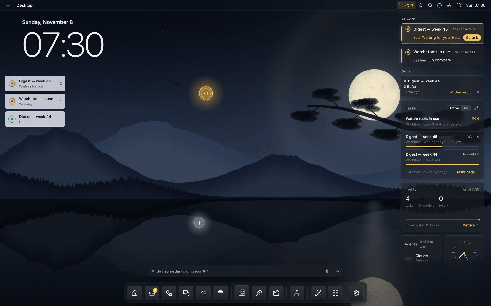
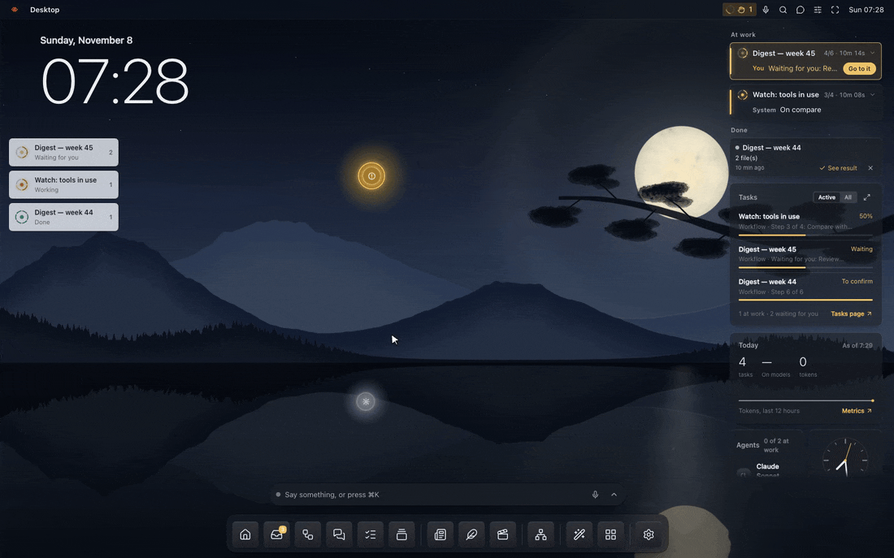
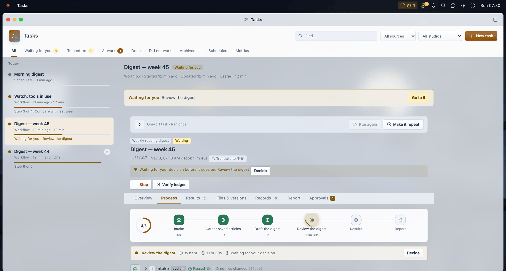
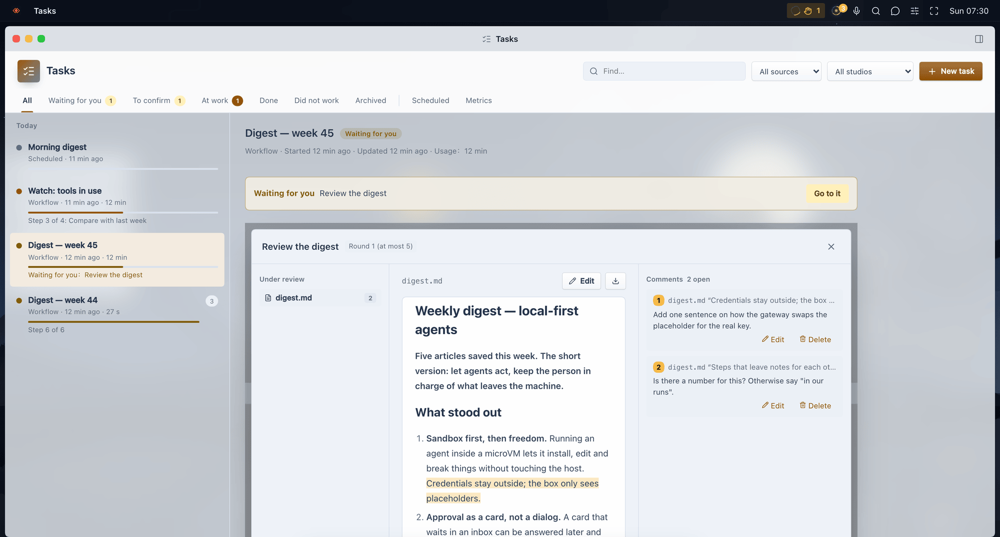
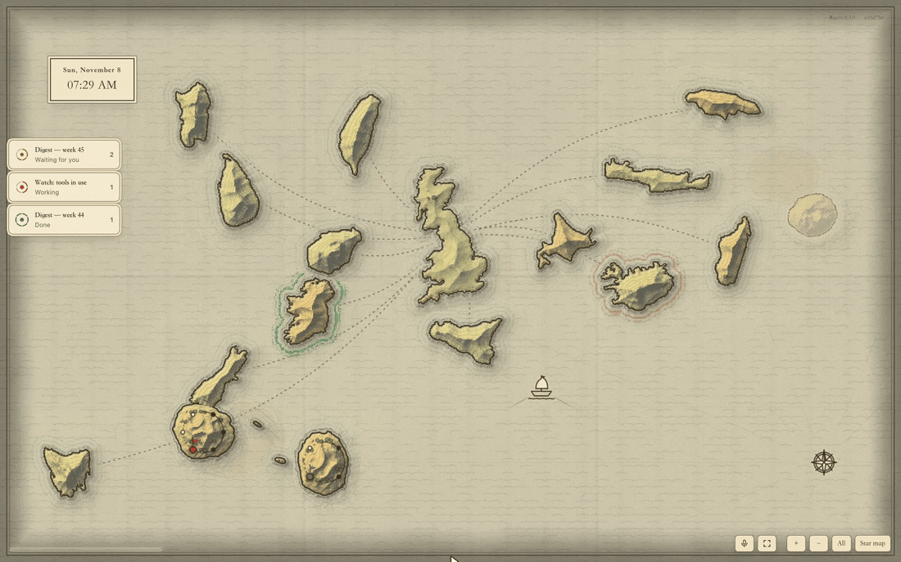

<p align="center"></p>

<h1 align="center">Ruyix</h1>

<p align="center"><b>An agent OS you can reshape — built on DSH</b><br>
English · <a href="README.zh-CN.md">中文</a></p>



Ruyix is a desktop for your agents. They work in workflows you can watch and steer: every step is on the record,
the files of a run keep a version per step, and anything that would leave the machine waits for your click. Its core
is customization — say what you want, and an agent changes the desk, the apps and the workflows for you; nothing
changes until you apply it, and every change can be undone.

It is a set of plugins for [DSH](https://www.npmjs.com/package/@deepseek-ai/dsh) (DeepSeek Harness). It runs on
macOS and Linux (not on Windows yet), and can run whole inside a microVM so agents may change anything in there without
reaching your computer.

*Ruyi* (如意) means "as you wish".

## Contents

- [What it does](#what-it-does)
- [Install](#install)
- [Run it in a box](#run-it-in-a-box)
- [Customize it](#customize-it)
- [What is in this repository](#what-is-in-this-repository)
- [Status](#status)
- [License](#license)

## What it does

### An agent proposes, you apply

An agent never changes your desk behind your back. Here a command-line agent ran `ruyix desk theme hills`: a card
shows exactly what would change, and the theme switches only when you click **Apply**. Ruyix's own agents use
built-in tools for the same; Claude Code or Codex in the box use the `ruyix desk` command and its skill.



Eleven themes come with it — live wallpapers drawn on the GPU, from aurora and neural light to classical Chinese
landscapes (far hills, ink wash, blue-green, moonlit lake). The whole desk is one hand-editable file,
`~/.ruyix/desktop.json`.

### Work you can see and steer

Everything an agent does is a **task**: a request in the chat, a session, a workflow run, a scheduled job. The
**Tasks** page holds them all — waiting for you, to confirm, at work, done, scheduled. A workflow run shows its steps
as a map, what each step handed back, the files with a version after every step, and its records. You can go back
to any step, change a file and carry on from there.



### Review where the text is

A workflow can stop for you at any step. The work is laid out whole — a document, a video, a set of posts — and
your comments sit on the passage they are about. Approve it, send it back to a step with your notes, or let the
agent revise in place and answer each comment.



### A desk that is a map

Besides the desktop and a classic sidebar layout, the desk can be an interactive map — an old sea chart, a star map
or a city of light. Every page, task and agent is a place on it; tasks moving through their steps move on the map.



### And around it

- **Agents of your choice.** Each agent runs on Claude Code, Codex, pi or DSH itself, with its model, effort and
  skills. Model endpoints (any OpenAI- or Anthropic-compatible address) are kept in one list in Settings.
- **A main agent, by chat or voice.** One agent you talk to; it can open pages, start work, make a small app or a
  studio, and answers with cards you can click. Hold a key and speak to it.
- **Studios.** Workspaces for one kind of work: **Plume** (one piece of writing adapted for X, Xiaohongshu and
  WeChat, checked against each platform's rules, published only after you review it), **Video** (footage check,
  an editable timeline, preview, MP4 and subtitles), **Newsletter** (sources, outline, draft, a check per paragraph,
  Markdown / HTML / text export).
- **Connections.** HTTP APIs, GitLab, Kubernetes, X, and cloud drives. Credentials stay in the connection; agents
  never see them.
- **Search for agents.** DeepSeek, Tavily, Bocha, Exa or Brave behind one setting; pages fetched directly or through
  a reader.
- **In a box:** Linux apps (GNOME apps, LibreOffice, terminals with tmux or Zellij) open as windows on the desk, and
  a shared browser agents can drive — you always make the last click on anything that publishes.

*The images above come from a fresh install with sample data: the "Weekly reading digest" workflow's steps are
scripts, so no model or account was needed to make them.*

## Install

You need Node.js 22.5 or newer, npm, pnpm and git, and DSH — the
[DeepSeek Harness](https://www.npmjs.com/package/@deepseek-ai/dsh) desktop app gives you its `dsh` command; without
it, the installer runs the tested version from npm. Agents on Claude Code or Codex need those CLIs signed in (or
install and sign in later under **Agents → Runtimes**).

```bash
git clone https://github.com/ethannortharc/ruyix.git
cd ruyix
node tools/dev-install.mjs        # npm install, build and check every package, install into the dsh profile "ruyix"
dsh --profile ruyix --no-open --host 127.0.0.1 --port 3280
```

Open the sign-in link it prints. `node tools/check-all.mjs` runs every package's build and self-checks.

## Run it in a box

Ruyix can run whole inside a [nookbox](#status) microVM: credentials stay in the host's vault and the box holds only
placeholders, swapped for the real values on the way out; every request is audited.

```bash
box/image/build.sh                                            # an OCI image from this source: ruyix:<version>-<commit>
nookbox create ruyix --image ruyix:<version>-<commit> --self-install
nookbox login claude ruyix                                    # agents sign in; their tokens stay on the host
nookbox exec ruyix -- ruyix link                              # the sign-in link
```

Inside a box, `ruyix upgrade` moves to a newer release and `ruyix upgrade --image` goes back to the image's.

## Customize it

```bash
ruyix desk                                   # how it looks now: the theme, every key, where the file is
ruyix desk themes                            # the themes
ruyix desk theme hills --summary "Far hills" # propose a theme (applied when you click)
ruyix desk set accent=blue scale=1.1
ruyix desk widget add note sm
```

`ruyix desk keys` lists every key of `~/.ruyix/desktop.json`. Edit the file directly and the desk follows within a
few seconds; a broken edit keeps the last good desk and tells you why. Applied changes are listed under
**Settings → Changes** (or `ruyix changes`), each with an undo.

## What is in this repository

| Folder | Package | What it is |
|---|---|---|
| `core/shell/` | `@ruyix/shell` | The desktop: wallpapers, windows, top bar, dock, ⌘K, the chat and voice, widgets, settings, changes an agent proposes, the `ruyix` command |
| `core/workbench/` | `@ruyix/workbench` | The workflow engine and its pages: tasks, runs, review steps, results, the inbox, the workflow editor |
| `core/plugins/agent-hub/` | `@ruyix/agent-hub` | The agents: runtimes, models, skills, sessions, jobs |
| `core/connectors/` | `@ruyix/connectors` | Connections and their credentials |
| `core/messages/` | `@ruyix/messages` | Messages between agents (also a CLI and an MCP server, usable without DSH) |
| `core/board/` | `@ruyix/board` | Dashboards: the format and the one renderer |
| `core/plugins/studio/` | `@ruyix/studio` | Studios: their records, pages and tools |
| `core/plugins/web/` | `@ruyix/web` | Search and page fetching for agents |
| `core/plugins/world/` | `@ruyix/world` | The interactive map desks ([make your own](core/plugins/world/MAKE-A-MAP.md)) |
| `core/plugins/apps/` | `@ruyix/apps` | The App Center: Linux apps, the terminal, the shared browser, apps an agent makes |
| `core/plugins/box/` | `@ruyix/box` | The box seen from inside: health, traffic, timeline, usage |
| `packs/plume/`, `packs/video/`, `packs/newsletter/` | `@ruyix/plume`, `@ruyix/video`, `@ruyix/newsletter` | The three studios |
| `box/image/` | — | The image a box runs, built from this source |
| `tools/` | — | Install from source, all checks, the release script |

How each part was designed is written down in [docs/design/](docs/design/) (in Chinese). What changed in each release: [CHANGELOG.md](CHANGELOG.md).

## Status

Ruyix is a personal project in active use, released as it is. The package names, the desk file and the APIs may
still change between minor versions. Releases are published to the author's own npm registry; installing from this
repository is the way for everyone else. Windows is not supported yet: several parts talk over Unix sockets, and its checks
fail there. The box needs nookbox, a separate project that is not public yet — without
it, Ruyix runs directly on your computer.

DSH (DeepSeek Harness) is a DeepSeek product; Ruyix is an independent project, not made by DeepSeek.

## License

[MIT](LICENSE). Bundled [pdf.js](core/workbench/vendor/pdfjs/LICENSE) is under the Apache License 2.0; the old map's
coastlines are made with [Natural Earth](https://www.naturalearthdata.com/) (public domain).

© 2026 Ethan H.B. Zhou
