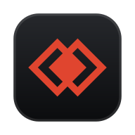
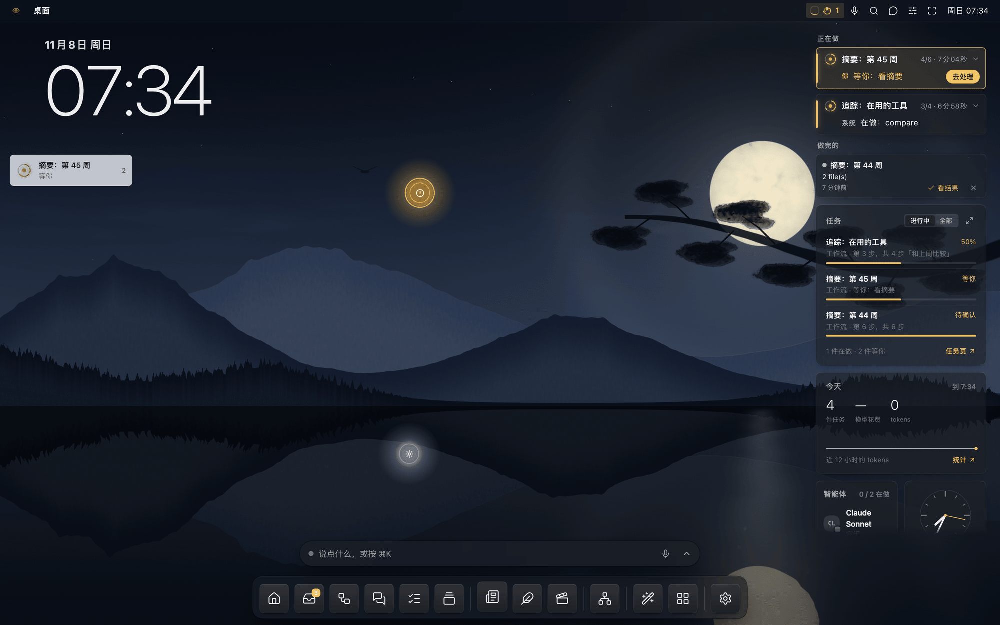
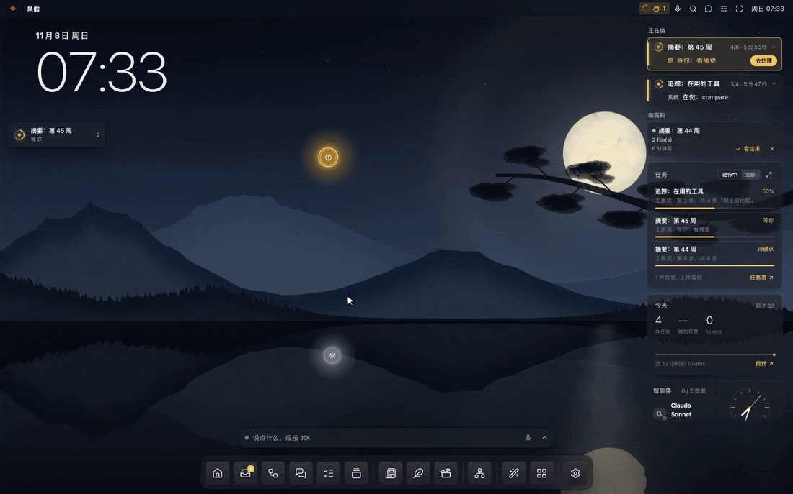
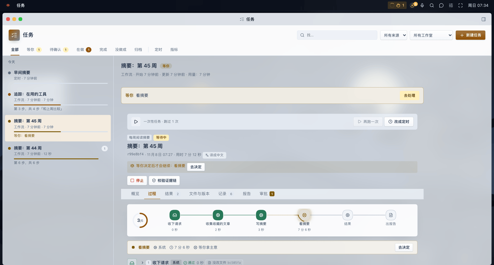
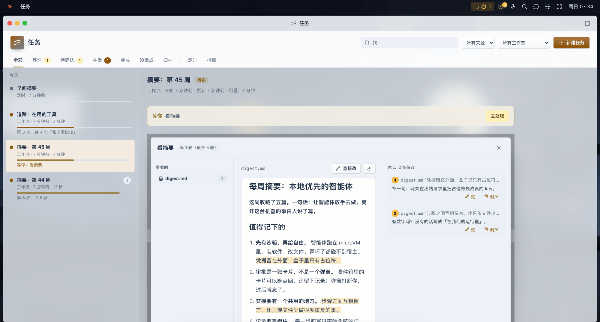
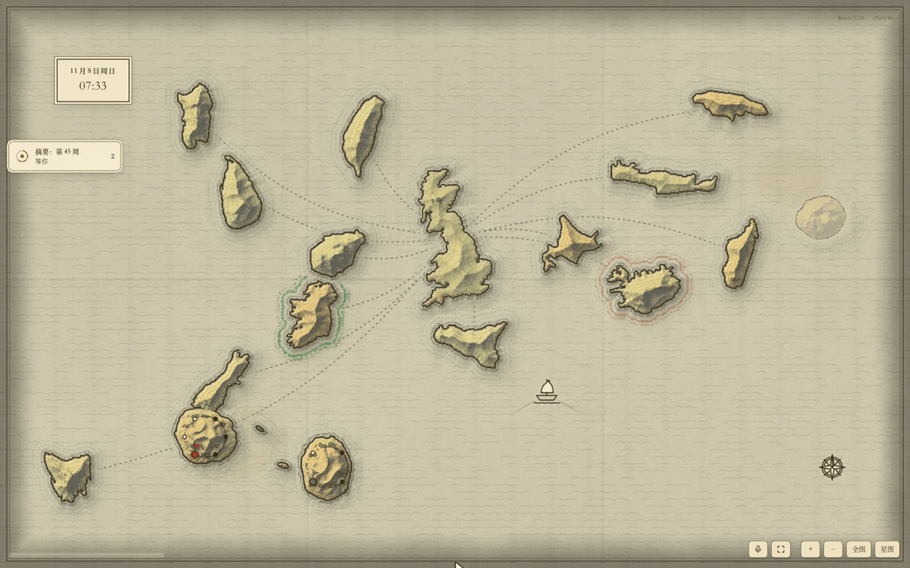

<p align="center"></p>

<h1 align="center">Ruyix</h1>

<p align="center"><b>如你所愿的 agent OS · built on DSH</b><br>
<a href="README.md">English</a> · 中文</p>



Ruyix 是给智能体用的桌面。它们在看得见、改得了的工作流里干活：每一步都有记录，一次运行的文件每一步留一个版本，
任何要离开这台机器的操作都先等你点头。它的核心是定制——你说要什么，智能体就把桌面、应用和工作流改成什么样；
你点了「应用」才生效，每个改动都能撤销。

它是一组 [DSH](https://www.npmjs.com/package/@deepseek-ai/dsh)（DeepSeek Harness）插件，macOS 和 Linux 上能跑（Windows 暂时不行）；
也可以整个放进一台 microVM，智能体在里面想改什么都行，碰不到你的电脑。

名字取自「如意」：照你的意思来。图标是方胜纹：两个方框斜放相叠，寓意同心、吉祥。

## 目录

- [能做什么](#能做什么)
- [安装](#安装)
- [在盒子里运行](#在盒子里运行)
- [定制](#定制)
- [仓库里有什么](#仓库里有什么)
- [现状](#现状)
- [许可](#许可)

## 能做什么

### 智能体提议，你来应用

智能体不会背着你改桌面。下面是一个命令行智能体运行了 `ruyix desk theme hills`：右下角出现一张卡片，列出要改的每一项，
你点了「应用」主题才换。Ruyix 自己的智能体用内置工具做同样的事；盒子里的 Claude Code、Codex 用 `ruyix desk` 命令和对应的技能。



自带 11 个主题，壁纸都是 GPU 实时画的：从极光、智能，到远山、水墨、青绿、月夜这样的古风山水。整个桌面就是一个
可以手改的文件 `~/.ruyix/desktop.json`。

### 看得见、管得了的工作

智能体做的每件事都是一个**任务**：对话里的一个请求、一个会话、一次工作流运行、一个定时的活。**任务**页把它们都放在一起：
等你的、待确认的、在做的、做完的、定时的。一次工作流运行能看到步骤图、每一步交回了什么、每一步之后的文件版本和全部记录；
可以回到任何一步、改一个文件，再从那里接着跑。



### 在原文上审阅

工作流可以在任何一步停下来等你。要审的东西整个摊开——一篇文档、一段视频、一组帖子——意见挂在它说的那一段上。
可以通过，可以带着意见退回某一步，也可以让智能体当场按意见改、逐条回复。



### 桌面也可以是一张地图

除了桌面和经典的侧栏布局，桌面还可以是一张能交互的地图：古地图、星图，或者一座光的城市。每个页面、任务、智能体都是
图上的一个地方；任务一步步往前走，图上也跟着动。



### 还有

- **智能体随你选。** 每个智能体跑在 Claude Code、Codex、pi 或 DSH 自己上面，各自选模型、强度和技能。模型接入点（任何兼容
  OpenAI 或 Anthropic 接口的地址）在设置里统一管理。
- **一个主智能体，打字或说话。** 你只跟一个智能体说话；它能打开页面、开始干活、做一个小应用或一个工作室，回答里带可以点的卡片。
  按住一个键就能对它说。
- **工作室。** 一类工作一个地方：**Plume**（一篇内容改写成 X、小红书、公众号的版本，按各平台的规则检查，你审过才发）、
  **视频**（素材检查、可编辑的时间线、预览、导出 MP4 和字幕）、**Newsletter**（来源、提纲、成稿、逐段核查，导出 Markdown / HTML / 纯文本）。
- **连接。** HTTP API、GitLab、Kubernetes、X、网盘。凭据只在连接里，智能体拿不到。
- **给智能体用的搜索。** DeepSeek、Tavily、博查、Exa、Brave 放在一个设置里；网页直接抓，或经阅读服务抓。
- **在盒子里：** Linux 应用（GNOME 应用、LibreOffice、带 tmux 或 Zellij 的终端）以窗口出现在桌面上；还有一个智能体共用、
  能操作的浏览器——凡是要发出去的，最后一下永远由你点。

*上面的图都来自一次全新安装加示例数据：「每周阅读摘要」这个工作流的步骤是脚本，所以截图时不需要任何模型或账号。*

## 安装

需要 Node.js 22.5 以上、npm、pnpm、git，以及 DSH——装了 [DeepSeek Harness](https://www.npmjs.com/package/@deepseek-ai/dsh)
桌面版就有 `dsh` 命令；没有时安装脚本从 npm 取测过的版本。要用 Claude Code、Codex 的智能体，需要这些命令行已登录
（也可以之后在 **智能体 → 运行时** 里装和登录）。

```bash
git clone https://github.com/ethannortharc/ruyix.git
cd ruyix
node tools/dev-install.mjs        # npm install、编译并自检每个包、装进 dsh 的 ruyix 配置
dsh --profile ruyix --no-open --host 127.0.0.1 --port 3280
```

打开它打印的登录链接。`node tools/check-all.mjs` 跑每个包的编译和自检。

## 在盒子里运行

Ruyix 可以整个跑在 [nookbox](#现状) 的 microVM 里：凭据留在宿主的保险库，盒子里只有占位符，出站时换回真值；每个请求都有审计。

```bash
box/image/build.sh                                            # 从这份源码打 OCI 镜像 ruyix:<版本>-<提交号>
nookbox create ruyix --image ruyix:<版本>-<提交号> --self-install
nookbox login claude ruyix                                    # 智能体在盒子里登录，令牌留在宿主
nookbox exec ruyix -- ruyix link                              # 登录链接
```

盒子里 `ruyix upgrade` 升到新版本，`ruyix upgrade --image` 回到镜像自带的版本。

## 定制

```bash
ruyix desk                                   # 现在的样子：主题、每个键、文件在哪
ruyix desk themes                            # 所有主题
ruyix desk theme hills --summary "换成远山"   # 提议换主题（你点了才生效）
ruyix desk set accent=blue scale=1.1
ruyix desk widget add note sm
```

`ruyix desk keys` 列出 `~/.ruyix/desktop.json` 的每个键。直接改这个文件，几秒内桌面跟着变；改错了会提示原因，桌面保持上一次
正确的样子。应用过的改动在 **设置 → 改动**（或 `ruyix changes`）里，每个都能撤销。

## 仓库里有什么

| 目录 | 包 | 是什么 |
|---|---|---|
| `core/shell/` | `@ruyix/shell` | 桌面：壁纸、窗口、顶栏、程序坞、⌘K、对话和语音、小部件、设置、智能体提议的改动、`ruyix` 命令 |
| `core/workbench/` | `@ruyix/workbench` | 工作流引擎和它的页面：任务、运行、审阅、结果、收件箱、工作流编辑器 |
| `core/plugins/agent-hub/` | `@ruyix/agent-hub` | 智能体：运行时、模型、技能、会话、后台任务 |
| `core/connectors/` | `@ruyix/connectors` | 连接和它们的凭据 |
| `core/messages/` | `@ruyix/messages` | 智能体之间的留言（也有命令行和 MCP 服务，不依赖 DSH 也能用） |
| `core/board/` | `@ruyix/board` | 看板：格式和唯一的渲染器 |
| `core/plugins/studio/` | `@ruyix/studio` | 工作室：记录、页面和工具 |
| `core/plugins/web/` | `@ruyix/web` | 给智能体用的搜索和抓网页 |
| `core/plugins/world/` | `@ruyix/world` | 交互式地图桌面（[自己做一张](core/plugins/world/MAKE-A-MAP.md)） |
| `core/plugins/apps/` | `@ruyix/apps` | 应用中心：Linux 应用、终端、共用浏览器、智能体做的小应用 |
| `core/plugins/box/` | `@ruyix/box` | 从盒子里面看盒子：状况、流量、时间线、用量 |
| `packs/plume/`、`packs/video/`、`packs/newsletter/` | `@ruyix/plume`、`@ruyix/video`、`@ruyix/newsletter` | 三个工作室 |
| `box/image/` | — | 盒子跑的镜像，从这份源码打 |
| `tools/` | — | 从源码安装、全部自检、发布脚本 |

每一部分怎么设计的，写在 [docs/design/](docs/design/) 里。每个版本改了什么：[CHANGELOG.md](CHANGELOG.md)（英文）。

## 现状

Ruyix 是一个在日常使用中的个人项目，按现在的样子发布。包名、桌面文件和接口在小版本之间还可能变。正式版本发布在作者自己的 npm 源上，
其他人从这个仓库安装。Windows 暂不支持：有几部分靠 Unix 套接字通信，在 Windows 上自检过不去。盒子需要 nookbox，那是另一个还没公开的项目；没有它，Ruyix 直接跑在你的电脑上。

DSH（DeepSeek Harness）是 DeepSeek 的产品；Ruyix 是独立项目，不是 DeepSeek 官方出品。

## 许可

[MIT](LICENSE)。附带的 [pdf.js](core/workbench/vendor/pdfjs/LICENSE) 是 Apache License 2.0；古地图的海岸线来自
[Natural Earth](https://www.naturalearthdata.com/)（公有领域）。

© 2026 Ethan H.B. Zhou
